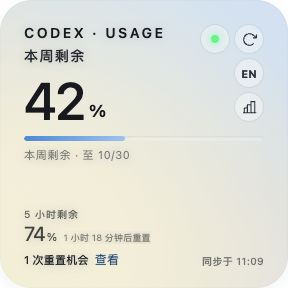
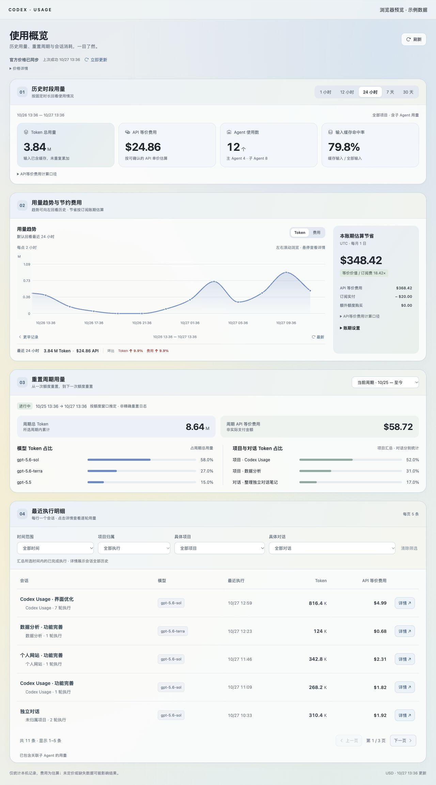

# Codex Usage · V1.0

**看清还能用多少，也看清用在了哪里。**

Codex Usage 是一个放在 Mac 菜单栏的 Codex 额度与用量工具。从剩余额度、重置时间，到项目、会话和每轮执行的 Token 与 API 等价费用，随手查看，按需深入。

[下载 Mac 版](https://github.com/Justinzouus/codex-usage/releases/latest) · [隐私说明](PRIVACY.md) · [统计口径](docs/ANALYTICS.md)



## 可以做什么

- **随手看额度**：菜单栏显示周剩余额度和重置机会；点击展开详情卡，查看周 / 5 小时窗口、倒计时与同步状态。
- **回看资源消耗**：大盘支持 1 小时到 30 天的用量趋势、模型分布与项目归属分析。
- **追到每轮执行**：按时间、项目、会话筛选，查看逐轮模型、Token 构成和可关联的子 Agent 用量。
- **用同一尺度比较**：自动更新官方 API 价格，按可确认的服务模式估价；未定价与数据缺口会提示。
- **填写自己的账期**：订阅费、扣款日、时区与额外额度由使用者自行填写，只保存在本机。
- **保持轻量**：额度卡支持中英文、手动刷新与开机启动；大盘当前为中文。



## 下载与使用

V1.0 提供 **macOS Apple Silicon（M1 及更新芯片）DMG**。构建最低系统要求为 macOS 11；本次原生验收在 macOS 27 / Apple Silicon 上完成，其他版本尚未逐一实测。Intel Mac 暂无预编译包。

1. 从 [Releases](https://github.com/Justinzouus/codex-usage/releases/latest) 下载 DMG，打开后把 **Codex Usage.app** 拖入 **Applications**。
2. 先在这台 Mac 安装并登录 Codex / ChatGPT，确保可找到其内置 Codex CLI 或单独安装的 `codex`。
3. 打开 Codex Usage，在菜单栏查看额度。点击卡片右上角图表按钮或右键菜单的“使用大盘”，查看历史统计。
4. 如需账期对比，展开大盘中的“账期设置”，填写自己的订阅信息；新安装不预置个人账期。

**签名状态**：本版本使用 ad hoc 临时签名，尚未进行 Apple Developer ID 签名或公证。首次打开可能被 Gatekeeper 阻止；确认下载来源和 SHA-256 后，可在“系统设置 → 隐私与安全性”按系统提示选择“仍要打开”。详见 [Apple 官方说明](https://support.apple.com/zh-cn/102445)。无需关闭系统安全保护。

应用找不到 CLI 时，可通过 `CODEX_CLI_PATH` 指定可信的 Codex 可执行文件。额度接口或历史格式变化时，可能需要更新 Codex Usage。

## 隐私与统计边界

- 本项目不读取 `auth.json`、API key 或 access token；额度由本机 `codex app-server` 使用自己的登录态取得。
- 用量历史在本机整理，不上传聊天记录。应用会读取项目名、路径、会话短标题及精简模式证据，因此分享截图与诊断资料前仍需脱敏。
- 联网仅用于 Codex 自身的额度查询及读取 OpenAI 官方公开价格文档；价格请求不携带本地用量、标题或路径。
- 历史仅覆盖这台设备可读的数据。重置周期由额度窗口推定；重置机会仅展示，不能在工具内兑换。
- **API 等价费用是参考估算，不能当作实际账单、套餐消耗或返现。** 缺少模式证据的历史按 Standard 估算。

## 从源码运行

需要 Node.js 22.12+、Rust stable、Xcode Command Line Tools 及 Tauri 2 的 macOS 构建依赖。

```bash
npm ci
npm test
cargo test --manifest-path src-tauri/Cargo.toml --locked
npm run tauri -- dev
```

浏览器预览运行 `npm run dev`，`?dashboard` 打开大盘；预览明确使用示例数据，桌面版读取真实本机数据。

构建 DMG：

```bash
npm run tauri -- build --bundles app,dmg
```

产物位于 `src-tauri/target/release/bundle/`。公开发布流程见 [RELEASING.md](RELEASING.md)。

## 技术与许可

React + TypeScript + Tauri 2 + Rust。非 OpenAI 官方产品，与 OpenAI 无隶属关系。

基于 [Quota Float](https://github.com/change-42-yhmm/quota-float) v0.1.3 的 MIT 许可代码改造，保留上游版权声明；菜单栏依赖补丁及许可见 [tray-icon](src-tauri/vendor/tray-icon/PATCH_NOTES.md)。

[MIT License](LICENSE)。欢迎通过 Issue 提交问题和建议，请先移除凭据、账户信息、个人路径与真实对话内容。
